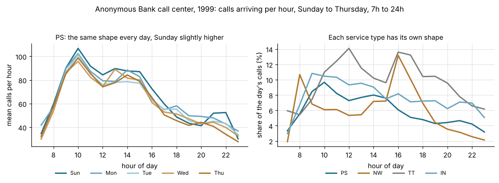
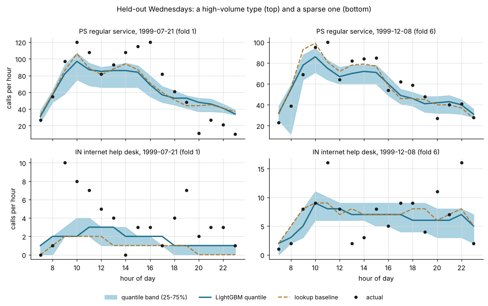
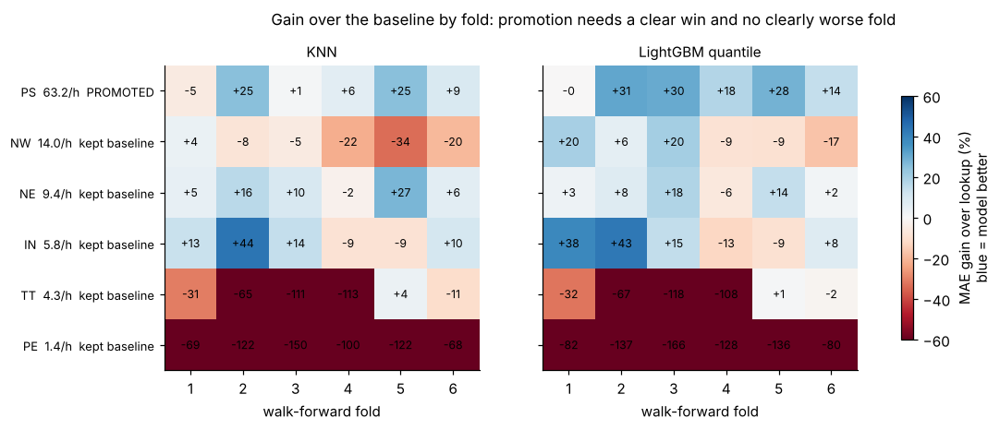
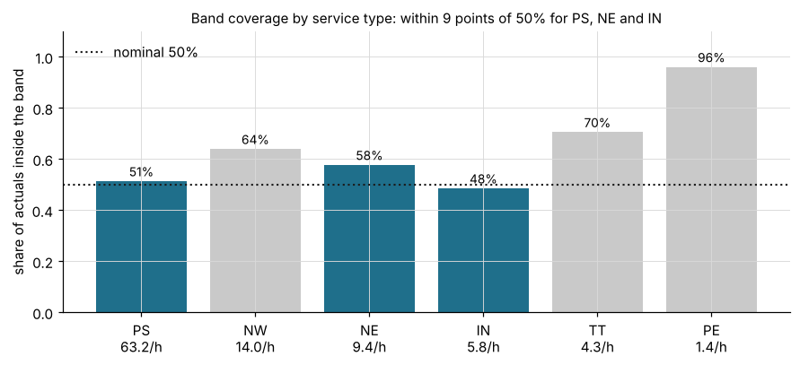

# Evaluation on a public call-center dataset

Everything else in this repository runs on generated data. This page records one run on real
call-center data that anyone can download, so the promotion rules and the quantile band can be judged
on something other than the generator. It also says what the run does not show.

## The data

The "Anonymous Bank" data is a call-by-call record of the telephone call center of an Israeli retail
bank for the whole of 1999: 12 monthly files and 444,448 records, one per call. Each record has the
time the call entered the voice response unit, a service type, the outcome, and the queue and service
times. The data was organized by Ilan Guedj and Avi Mandelbaum at the Technion SEE Laboratory, which
publishes it at <https://seelab.net.technion.ac.il/data/>. The authors state that the data is free
for use and ask users to notify Avi Mandelbaum and to acknowledge the source. There is no formal
licence.

Acknowledgement: call-center data of "Anonymous Bank", Israel, 1999, organized by I. Guedj and
A. Mandelbaum, Technion SEE Laboratory (<https://seelab.net.technion.ac.il/data/>), used under the
authors' terms ("free for use, acknowledge the data source").

This repository does not contain the data. `call_pace.anonymous_bank.fetch` downloads the archive
from the Technion host and checks the SHA-256 of the archive, of the documentation and of each monthly
file before it writes anything. The expected values are pinned in `src/call_pace/anonymous_bank.py`.
The University of Bern mirrors the same files, but its copy differs from the original in the 12 rows
that are malformed there, so the pinned hashes refer to the Technion files.

The center is staffed Sunday to Thursday from 7:00 to midnight. There are six service types:

| Type | Service |
|---|---|
| PS | regular activity |
| PE | regular activity in English |
| IN | internet help desk |
| NE | stock exchange activity |
| NW | prospective customers asking for information |
| TT | customers who asked to be called back and were called by the system |

This is inbound customer service of a bank, with a weekday calendar and several queues of very
different volume, which is the setting the package was written for. It is not debt collection, and the
data is from 1999.

## Preparation

An event is a call arriving, timed at the moment it enters the voice response unit, and each service
type is one bucket. `clean_calls` drops what the documentation or the data rules out and counts every
drop:

| Step | Rows |
|---|---|
| Records in the 12 files | 444,448 |
| Malformed rows (the `type` cell is missing and the cells after it shift left) | 12 dropped |
| `type` with a trailing space (`TT `) | 6 fixed |
| Outcome `PHANTOM`, which the documentation says to ignore | 3,599 dropped |
| Type `AA`, which the documentation does not describe | 5 dropped |
| Calls kept | 440,832 on 363 calendar days |
| Calls inside the modelled window (Sunday to Thursday, 7h to 23h) | 397,564 on 258 operating days |

The 43,268 calls outside the window arrived on Friday, on Saturday or at night.

## Protocol

`anonymous_bank_config()` returns this configuration:

```text
start_hour=7, end_hour=23, operating_weekdays=(0, 1, 2, 3, 6), first_window_hours=3,
n_folds=6, fold_size_days=20, min_train_days=100
```

Weekdays are numbered from Monday = 0, so `(0, 1, 2, 3, 6)` is Sunday to Thursday. The walk-forward
evaluation uses six folds of 20 operating days each at the end of the series (about July to December
1999), with an expanding training window. Every other setting is the package default: the baseline is
the median per bucket and hour over the trailing 60 days, the band runs from the 25th to the 75th
percentile, and the promotion rules are the ones in the README. The full run takes about seven
seconds.

## Results



MAE is the mean absolute error in calls per hour, averaged over the six folds. The last-fold columns
are the holdout the promotion rules look at.

| Type | Calls per hour | MAE lookup | MAE KNN | MAE quantile | Last fold: lookup / KNN / quantile | KNN | Quantile | Band coverage |
|---|---|---|---|---|---|---|---|---|
| PS | 63.2 | 15.01 | 13.58 | 11.92 | 13.19 / 11.97 / 11.34 | keep baseline | promote | 51% |
| NW | 14.0 | 5.09 | 5.68 | 4.85 | 4.24 / 5.07 / 4.96 | keep baseline | keep baseline | 64% |
| NE | 9.4 | 3.44 | 3.04 | 3.19 | 3.32 / 3.12 / 3.27 | promote | keep baseline | 58% |
| IN | 5.8 | 4.31 | 3.64 | 3.42 | 3.73 / 3.34 / 3.44 | keep baseline | keep baseline | 48% |
| TT | 4.3 | 1.69 | 2.33 | 2.32 | 2.27 / 2.51 / 2.31 | keep baseline | keep baseline | 71% |
| PE | 1.4 | 0.37 | 0.75 | 0.81 | 0.43 / 0.72 / 0.77 | keep baseline | keep baseline | 96% |

Overall, 64% of the actual counts fall inside a band meant to hold 50%.



The promotion rules ask for a clear win on the last fold, a directional accuracy of at least 55% and
no fold clearly worse than the baseline. The next figure shows the gain over the baseline fold by
fold.





## A baseline that knows the weekday

The package baseline ignores the day of the week. To check that this does not make it a weak
reference, the script also scores a lookup keyed by (bucket, weekday, hour) over the same trailing
window and the same folds. It is a reference only and does not enter the promotion rules.

| Type | MAE lookup | MAE lookup by weekday | Last fold: lookup / lookup by weekday |
|---|---|---|---|
| PS | 15.01 | 14.94 | 13.19 / 13.41 |
| NW | 5.09 | 5.05 | 4.24 / 4.01 |
| NE | 3.44 | 3.43 | 3.32 / 3.21 |
| IN | 4.31 | 4.35 | 3.73 / 3.77 |
| TT | 1.69 | 1.83 | 2.27 / 2.33 |
| PE | 0.37 | 0.39 | 0.43 / 0.44 |

The two baselines are within 8% of each other for every type, and within 2% for the busiest one. On
this data the day of the week adds almost nothing to the lookup, so the gains in the table above do not
come from a baseline that lacks it. The weekday profiles of PS in the first figure show why: the shape
of the day is nearly the same from Sunday to Thursday.

## Reading the results

The quantile model is promoted for PS, the type with the highest volume, where it lowers the last-fold
error from 13.19 to 11.34 calls per hour (14%). The KNN is promoted for NE. For the other four types the
baseline stays. IN shows the reason for the third rule: the quantile model has a lower mean error and a
7.8% gain on the last fold, but it is worse than the baseline on folds 4 and 5, so it is not promoted.
That is the behaviour the README describes, and it is why the decision is made per bucket.

The band is within 9 points of its nominal level for PS (51%), IN (48%) and NE (58%). It is too wide
for NW, TT and PE. For the smallest types the counts are a few calls per hour, so the 25th and 75th
percentiles sit on whole numbers and the band covers far more than half of the outcomes.

## What this does not show

The data comes from one site, one year and six folds, so the differences between models are small
compared with the fold-to-fold spread, and no significance test was run. One event definition
(arrivals) and one configuration were run. The result says nothing about outbound calling or
collections, and nothing about call centers today. The run used Python 3.13 on Linux with numpy 2.5,
pandas 2.3, scikit-learn 1.9 and LightGBM 4.7. The KNN figures can differ on another platform or
library version.

## Reproduce

```bash
pip install -e ".[dev,realdata]"        # realdata adds unrar-cffi, which reads the RAR archive, and matplotlib
python scripts/evaluate_anonymous_bank.py --data data --out data/results --figures docs/img
```

The first run downloads about 10 MB into `data/`, which git ignores and which must stay out of the
repository. The script prints the cleaning counts and the results table, writes
`data/results/anonymous_bank.json` and redraws the four figures. `tests/test_anonymous_bank.py` covers
the cleaning rules and the hash checks on invented rows and does not use the network.
